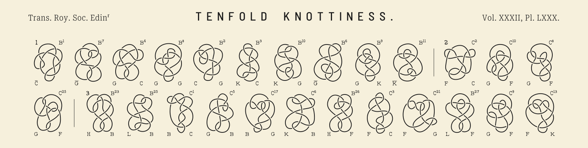
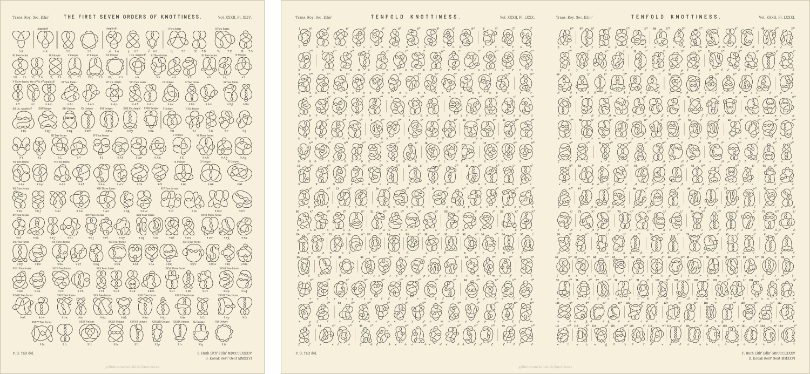

# Knottiness



Faithful vector reconstructions of P. G. Tait's knot tables as posters: every knot follows Tait's
original drawing closely but is rendered with proper over/under crossings, together with Tait's
annotations. Several errors in the annotations of the original tenfold plates were corrected; they are listed in
[`tenfold/README.md`](tenfold/README.md#errors-and-inconsistencies-in-the-1885-publications).

| Poster | Directory |
|---|---|
| **Tenfold Knottiness**: Plates LXXX and LXXXI of *On Knots. Part III*, Trans. Roy. Soc. Edinburgh 32 (1885); 364 forms of the 123 alternating ten-crossing knots | [`tenfold/`](tenfold/README.md) |
| **The First Seven Orders of Knottiness**: Plate XLIV of *On Knots. Part II*, Trans. Roy. Soc. Edinburgh 32 (1884); 144 forms of the alternating knots of 3 to 9 crossings | [`seven-orders/`](seven-orders/README.md) |

The entire code in this repository was written by Claude Opus 5.5 and Claude Sonnet 5.5 under extensive supervision and guidance by Dmitry Kobak.



*The First Seven Orders of Knottiness (one A3 page) and Tenfold Knottiness, shown here as the combined A2 sheet. Tenfold Knottiness is available both combined on one sheet and as two separate A3 pages, one per plate.*

## Layout

```
tenfold/          one directory per poster, each with
seven-orders/       sources/   original scans and texts (provenance in sources/README.md)
                    data/      transcriptions and hand-made decisions
                    scripts/   the scripts specific to this poster
                    traced/    accepted traces (geometry only)
                    output/    generated: rendered knots, review sheets, the poster
tait/             Python package shared by the posters: segmentation, tracing, validation,
                  rendering, Tait's lettering (tait.Poster: the directories of a poster)
scripts/          scripts shared by the posters: trace_rows.py, review_sheets.py (--plate LXXX,
                  LXXXI or XLIV), render_knots.py, edit_glyphs.py, plot_glyphs.py (--poster
                  tenfold|seven-orders, the default when run from inside a poster's directory),
                  make_readme_images.py (the images of this README)
docs/             the images of this README (cover.png, posters.png), made from the finished posters by
                  scripts/make_readme_images.py
fonts/            the fonts of headers and footers (Roboto Serif subset), with their licences (SIL Open Font
                  License) and README
pyproject.toml, uv.lock, .python-version   project definition for uv
```

## Setup

The project is managed with [uv](https://docs.astral.sh/uv/). `uv sync` at the repository root
creates `.venv/` with the Python version from `.python-version` and the exact dependency versions
from `uv.lock`, and installs the `tait` package itself (editable). Then work from inside a poster's
directory (see its README); uv finds the project from any subdirectory:

```bash
uv sync
cd tenfold
uv run scripts/build_poster.py
uv run ../scripts/render_knots.py          # shared script; --poster defaults to the current poster
```

`cairosvg` (review sheets, PNG/PDF output) needs the system Cairo library: usually present on Linux;
on macOS `brew install cairo`.

To add a dependency: `uv add <package>` (updates `pyproject.toml` and `uv.lock`; commit both).

## Order of work

The posters share code and fonts, and seven-orders also uses one data product of tenfold: the traced
annotation glyphs (`tenfold/traced/glyphs.json`), in which both posters set their labels. To
reproduce everything from scratch, **run `tenfold/` first**, at least through its `trace_glyphs.py`:

```bash
uv sync

# 1. tenfold/   (scans in tenfold/sources/, see its README)
cd tenfold
uv run scripts/build_census.py
uv run ../scripts/trace_rows.py --plate LXXXI --rows all
uv run ../scripts/trace_rows.py --plate LXXX --rows all
uv run scripts/trace_glyphs.py              # -> tenfold/traced/glyphs.json, used by seven-orders
uv run ../scripts/render_knots.py
uv run scripts/build_poster.py

# 2. seven-orders/   (scan in seven-orders/sources/, see its README)
cd ../seven-orders
uv run scripts/build_census.py
uv run ../scripts/trace_rows.py --plate XLIV --rows all
uv run ../scripts/render_knots.py
uv run scripts/trace_glyphs.py              # reads ../tenfold/traced/glyphs.json
uv run scripts/build_poster.py
```

Why in this order:

- `tenfold/scripts/trace_glyphs.py` collects the letters and digits from the labels of the traced
  tenfold knots, so it needs `tenfold/traced/<seq>.json` and `tenfold/data/census.csv` (the
  `trace_rows.py` steps).
- `seven-orders/scripts/trace_glyphs.py` traces only the letters the tenfold plates lack (i j m n v w x
  y z and the comma), scaled and thickened to match the tenfold set, so it needs
  `tenfold/traced/glyphs.json`; both `build_poster.py` scripts read that file too. If the tenfold glyphs
  are re-traced, re-run the seven-orders glyph step.
- Nothing in `tenfold/` depends on `seven-orders/`.
- `trace_rows.py` writes the knot SVGs at the default line width; `render_knots.py` re-renders them at
  the poster's width (6.5), so it comes before `build_poster.py`.

The accepted traces (`*/traced/`), the glyph sets and all data are committed, so a poster can also be
rebuilt from a fresh clone without the scans: `render_knots.py` (if the style changed) and
`build_poster.py` only. The scans are needed for `trace_rows.py` and `trace_glyphs.py`.

## Sources

Everything is reconstructed from works published in 1884 and 1885 (public domain); each poster's
`sources/README.md` lists the scan files with their provenance, resolution and role.

- P. G. Tait, *On Knots. Part II*, Trans. Roy. Soc. Edinburgh 32 (1884), 327–342, Plate XLIV.
  [doi:10.1017/S0080456800026806](https://doi.org/10.1017/S0080456800026806)
- P. G. Tait, *On Knots. Part III*, Trans. Roy. Soc. Edinburgh 32 (1885), 493–506, Plates LXXIX–LXXXI.
  [doi:10.1017/S0080456800025242](https://doi.org/10.1017/S0080456800025242)
- T. P. Kirkman, *The 364 unifilar knots of ten crossings, enumerated and described*,
  Trans. Roy. Soc. Edinburgh 32 (1885), 483–491.
  [doi:10.1017/S0080456800025230](https://doi.org/10.1017/S0080456800025230)
- Scans of the plates: HathiTrust (Penn State copy), the Knot Atlas, the Internet Archive (Natural
  History Museum, London copy), and the Cambridge Core PDFs of the papers (details and links in
  [`tenfold/sources/`](tenfold/sources/README.md) and [`seven-orders/sources/`](seven-orders/sources/README.md)).
- Fonts: Barlow Semi Condensed and Roboto Serif, SIL Open Font License (`fonts/`).

## License

The code, the traced data and the posters made by this project are released under the
[MIT License](LICENSE). The scans in the `sources/` directories are not covered by it; they are
reproductions of works from 1884 and 1885, and the digitisations come from the providers named in
the `sources/` READMEs. The fonts in `fonts/` are under the SIL Open Font License (licences in that
directory).
