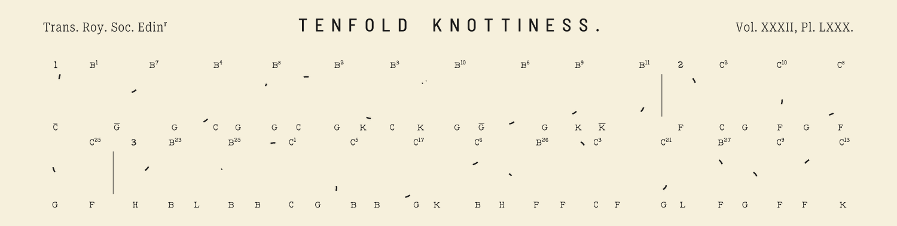
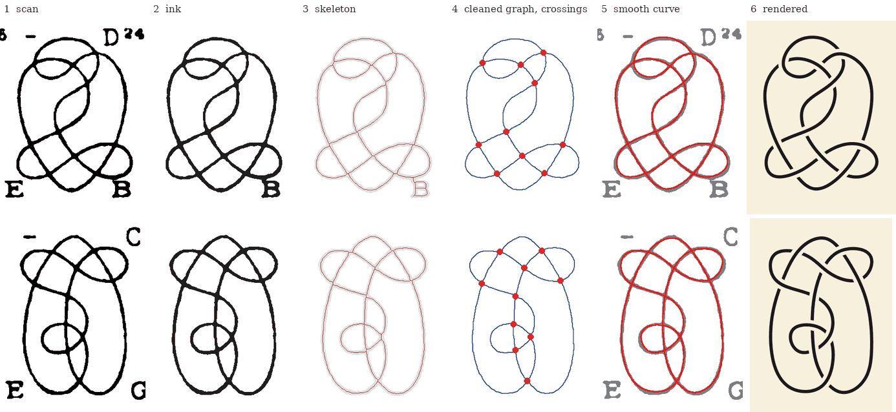
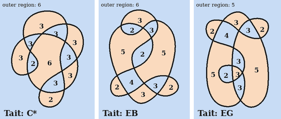
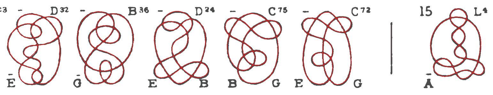
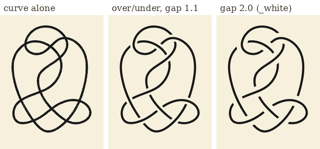
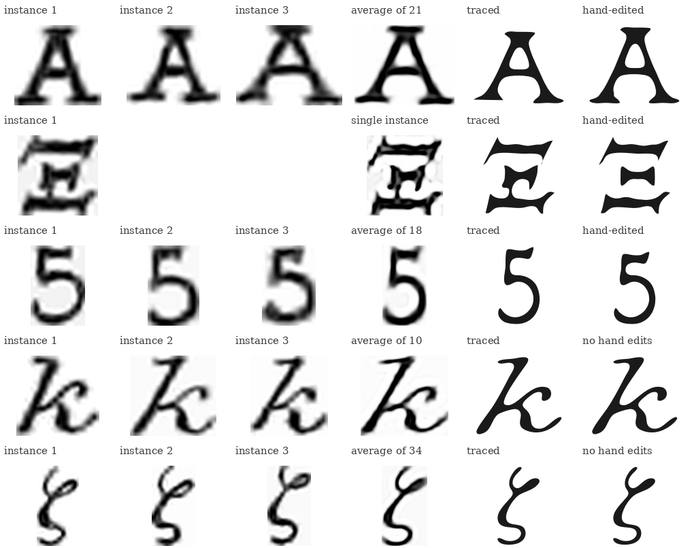

# The making of Knottiness

## 1. The starting point

In 1884–85 P. G. Tait drew the knots up to ten crossings by hand, and F. Huth lithographed them onto plates. Each
knot is a single closed curve, drawn **without any over/under information**: every line is continuous, and at a
crossing you cannot tell which strand goes on top. Tait could leave that out because all his knots are
*alternating* (the strand goes over, under, over, under, all the way round), so the curve alone fixes the knot,
up to mirror image.

Around every knot Tait put annotations, all hand-lettered:

- top left, the number of the knot's *type* (on the first form of each type only);
- top right, the knot's name in T. P. Kirkman's list (for example `B`28);
- at the bottom, two letters that encode the diagram's regions (explained in section 5).

The goal: **redraw every knot as clean vector art that follows Tait's drawing closely, but with proper
over/under crossings, together with all of his annotations.** That splits into three jobs: recover each knot's
curve from the scans, draw it with crossings, and recover the lettering.

## 2. The big picture

The work runs along three lines that meet in the poster script.

First, each plate is found in the scans and cut into knots. Every knot is traced into a curve, and the curve is
checked against Tait's own region letters. The curves are saved as `traced/<n>.json`, one file per knot. Next to
them is `data/census.csv`, which holds Tait's printed list of the 364 forms and Kirkman's labels, both transcribed from the
page images.

Second, the letters and digits of Tait's annotations are collected from the scans, averaged, and traced into outlines,
saved as `traced/glyphs.json`.

Third, the poster script reads the census, the traces and the glyphs, draws each knot with over/under crossings, sets
the annotations, and lays out the page.

The traced files are committed, so drawing the posters needs only them, not the scans.

## 3. Several scans, one answer

No single scan is good enough, so the code uses three and keeps, for every knot, the first one that gives a
**valid** trace:

| Scan | Strength | Weakness |
|---|---|---|
| HathiTrust (Google's scan) | large, clean black-and-white; the primary source | first column of Plate LXXX is cropped; some thin lines break into dots |
| Knot Atlas PNG | complete, including the first column | small |
| Internet Archive photo | a sharp greyscale photo, the best source for lettering | first column hidden in the binding |

In the end the HathiTrust scan supplies 341 of the 364 knots, the Knot Atlas 22, and the Internet Archive photo one.
The scans do not line up with each other, so for each pair the code fits a simple affine map (shift, scale, slight
rotation) on the knots they share, and then pairs knots by position. A knot missing from one scan then only affects
that knot.

## 4. Finding the knots, and numbering them

The code first marks everything dark as ink, but uses only the **large** connected pieces to find knot bodies, so
that a nearby label cannot glue two knots together. Knot boxes are sorted into rows. The census number of each knot
is its position in reading order, which matches Tait's printed list of all 364 forms. That list, and Kirkman's
labels, were transcribed by Claude from the page images and are checked wherever a check is possible
(see [`tenfold/data/README.md`](../tenfold/data/README.md)).

All thresholds are expressed as fractions of the knot size (the *working scale* is 314 px per knot height), so
the same settings work for every scan, whatever its resolution.

## 5. From ink to a curve

For each knot:

1. **Ink.** Threshold the scan (a fixed threshold for the black-and-white scans, a local one for the photo).
2. **Skeleton.** Thin the ink to a one-pixel-wide line.
3. **Graph.** Read the skeleton as a network: crossings and junctions become nodes, the stretches in between
   become edges. A real crossing has four ways out.
4. **Clean-up.** The skeleton of a real scan has defects (the label letter `B` is picked up in the skeleton column, for
   example). Short spurs are pruned; a crossing that the skeleton split into
   two nearby junctions is merged back; small gaps in thin lines are bridged; tiny loops caused by ink blots or by
   a label touching the knot are removed. The order matters. For example, split crossings are merged *before* gaps
   are bridged, so that a stray dot cannot connect to a finished crossing.
5. **Curve.** Follow the strand through the crossings (going straight on at each) and fit a smooth periodic
   spline through it, which stays within about 2 working pixels of the printed line.

The tracing stores **geometry only**: the curve, the crossing positions and where on the scan the knot was. How the
knot is *drawn* (line width, gaps, colour) is decided later, so the style can change without tracing again.

### How do we know a trace is right?

A trace can be wrong without looking wrong, for example with a missed gap or an extra loop. A trace is therefore
**accepted only if it passes checks that do not depend on how it was made**:

- it is exactly **one closed strand**;
- it has exactly **10 crossings** (the right number for the plate);
- the **regions of the diagram match Tait's printed letters**.

The third check uses the regions of the diagram. The curve cuts the plane into regions (the loops and gaps between
strands). Colour them like a checkerboard, so that regions meeting along an edge get different colours. Now count,
for each region, its corners (crossings on its boundary). In each colour the corner counts add up to 20, and
Tait's two region letters stand for those two lists of numbers. The second letter is the colour of the outer region.

Above, the corner counts are computed from our traced curves, with no reference to the printed letters, and agree
exactly with them for every knot shown. A trace with the wrong counts is rejected. When a knot traced cleanly but its counts
disagreed with the printed letters, the letters were misprinted; this is how the reversed letters of knot 352 were
found (see the table in [`tenfold/README.md`](../tenfold/README.md#errors-and-inconsistencies-in-the-1885-publications)).
A second, independent check compares each Kirkman label's letter with the number of "flaps" (twists) in the traced
knot, as defined in Kirkman's paper (`tenfold/scripts/check_kirkman.py`).

The result for a row of the plate: the accepted curves (red) sit on the printed lines. (The first knot of the row
is not drawn here because the HathiTrust page is cropped there; its trace comes from another scan.)

## 6. Over and under

Since the knots are alternating, the over/under follows from alternating along the curve: the strand goes
over at the first crossing it meets, under at the next, over at the next, and so on. The plates carry no information about
handedness, so the poster does not pick one mirror image for all knots. It starts the alternation at the first crossing
passage of each stored curve.

The drawing is made as **one filled outline per knot**, not as a stroke with white patches painted over it. For every
crossing the *under* strand is cut away where it passes through the *over* strand's band (its width plus a margin on
each side). Two consequences:

- the edges of a gap are always parallel to the over-strand, whatever the angle of the crossing;
- there are no background-coloured shapes, so the file works on any paper colour.

A cut never reaches past the halfway point to the next crossing along the same strand, which keeps tight loops intact.
The outline is written out as cubic Bézier curves, fitted to within 0.1 px of the exact shape, so it stays smooth at any
zoom.

The gap is a parameter: **1.1** line widths on each side for the paper-tone files, **2.0** for the `_white` files.
The wider gap exists for home printing: ink bleeds a fixed amount, which is a larger share of a small gap, and the gaps
on an A4 print would otherwise nearly close up.

## 7. The lettering

Tait's annotations were lettered by hand on the lithographic stone. Instances of one letter differ in height by 4–8 %
and visibly in shape, so **no font matches them**. The code therefore traces the letters from the scans themselves.

The recipe, per letter or digit (84 glyphs in all for the tenfold plates):

1. **Collect instances.** The code knows from the census what is printed near each knot (its two region letters, its
   Kirkman letter, its type number). It cuts those out of the scan, tens of times for common letters.
2. **Average them.** Each instance is enlarged about four times, aligned to the most typical one (allowing small
   differences in scale, shear and rotation), and the instances that match are averaged. Because the instances sit at different
   sub-pixel positions on the scan, the average shows detail finer than one scan pixel. The optical blur of the scan is then
   reduced by deconvolution. (The *average of 21* `A` above is visibly crisper than any single instance.)
3. **Trace the outline.** Letters in the typeface style (capitals, digits) are traced at the 50 % ink level and the corners and
   straight edges are rebuilt. The calligraphic ones (italics, Greek) at a lower level, so as not to lose hairlines.
4. **Make the weights consistent.** All outlines are offset to one common stroke width, and each has its measured baseline and
   descender.
5. **Hand edits.** Where the scan could not give a clean result, a short instruction in
   [`tenfold/data/glyphs.yaml`](../tenfold/data/glyphs.yaml) patches the outline: stretch a bar, mirror a good foot onto a damaged
   one, copy a serif from another letter, cut an ink blot. The edits are re-applicable without the scans. The `A` above got a
   thicker, mirrored left foot; the `Ξ` (a single instance, with an ink blot joining its middle and bottom bars) had its
   middle bar rebuilt from the arm of an `E` and the leftover stalk cut away.

The seven-orders poster needs a few letters that the tenfold plates never print (`i j m n v w x y z` and a comma). They are
traced from that plate's own labels by the same method and scaled to match the tenfold set.

## 8. Putting the poster together

Layout is proportional: every size is a fraction of the page, so the posters can be printed at any A size.

- The 364 knots sit on a grid of 14 rows by 13 columns per plate, read from the positions found in step 4. Rows are justified to
  the plate width, with a thin separator wherever the type changes. All knots share one scale. A knot fills 72 % of its row.
- The four annotations go at each knot's corners, set in the traced glyphs. Labels share a baseline per row and are pushed outwards
  until they clear the knot's outline. A check reports any text closer than 0.35 font sizes to anything else (currently none).
- The header and footer are in free fonts close to the originals' lettering, drawn as outlines, so the SVG and PDF need no installed
  fonts. Their text is explained below.
- Each poster exists on a paper tone and on white, as SVG, PDF and PNG; Tenfold Knottiness is a single A2 sheet or two A3 pages,
  one per plate.

### Header and footer

On the plates:

- **Header, left:** Trans. Roy. Soc. Edinr is *Transactions of the Royal Society of Edinburgh*, the journal the papers appeared in.
  The small dot under the raised r is the full stop of the abbreviation, as on the plates; the same goes for Lithr, Restr and the
  group headers' Amphichl.
- **Header, right:** `Vol. XXXII, Pl. LXXX.` is volume 32, plate 80, in Roman numerals. The title stands between them.
- **Footer, left:** `P. G. Tait del.`, where *del.* is short for *delineavit*, Latin for "drew it": Tait drew the figures.
- **Footer, right:** F. Huth Lithr Edinr, meaning F. Huth, lithographer, Edinburgh: the firm that made the lithographic plates
  from Tait's drawings.

What we added, in the same style:

- **The years** `MDCCCLXXXV` (1885) on the tenfold poster and `MDCCCLXXXIV` (1884) on the seven-orders poster. The plates print no
  year; we took it from the papers and wrote it in Roman numerals like the plate numbers.
- **A second credit line,** D. Kobak Restr Ghent MMXXVI: *Rest.* for "restorer", Ghent as the place, 2026 as the year,
  laid out like the lithographer's line above it.
- **The project's address,** `github.com/kobaklab/knottiness`, centred below the footer in a faint tone.

## 9. The seven-orders poster

*The First Seven Orders of Knottiness* (Plate XLIV of *On Knots, Part II*, 1884) reuses all of this. Differences:

- one source scan was enough (the paper's PDF, whose plate page is a clean 300 ppi black-and-white image);
- the validation is against the *pair of partitions* that Tait prints in the paper's text for each figure, not letters;
- the layout keeps the arrangement of Tait's plate instead of a regular grid, which is how the tenfold poster is laid out. The
  rows hold 9 to 14 figures, a header ("III Two forms") stands over the first figure of each group, and double bars separate the
  orders. It is adjusted slightly to match the tenfold pages: the same page, margins, header and footer; one scale for the whole
  plate; every row except the shorter last one is stretched to the full width (all its gaps widened by the same factor, 1.03 to
  1.17); and the rows are spread evenly over the page.

## 10. Choices, and roads not taken

- **Geometry apart from style.** Traces store only curves, so line weight, gaps and colours were changed many times without
  re-tracing.
- **One outline per knot** instead of a line with white patches, so any paper colour works and the gaps are exactly parallel to the
  over-strand.
- **A "ribbon" style** (as in Tait's Plate LXXIX) was considered but not pursued.
- **Glyph reconstruction by geometry.** Reconstructing letters from templates of strokes and serifs was tried and dropped:
  fitting the traced ink gave better, more faithful results, with a few hand edits. Those experiments were removed from the code.
- **Corrections to Tait.** Where the printed annotations are wrong (a misprinted Kirkman label, a duplicated one, a reversed region
  code), the poster shows the corrected version and the census records what was printed. Details are in
  [`tenfold/README.md`](../tenfold/README.md#errors-and-inconsistencies-in-the-1885-publications).
- **Equal margins.** The footer text hangs below its band while the header is centred in its band, which left more white above
  the title than below the footer; the content was moved up so that both are equal.
- **Repository size.** The HathiTrust pages were recompressed from 6 MB JPEGs to 1-bit PNGs (the pages are black and white); the
  Roboto Serif font was subset to Latin; the poster PNGs are not committed, only four PDFs.
- **Reproducibility.** The tracing is deterministic: rerunning it from the scans with the locked environment gives the committed
  traces, and rebuilding the posters from the committed files gives the committed posters.

To run everything, see the order of work in the [main README](../README.md#order-of-work).
